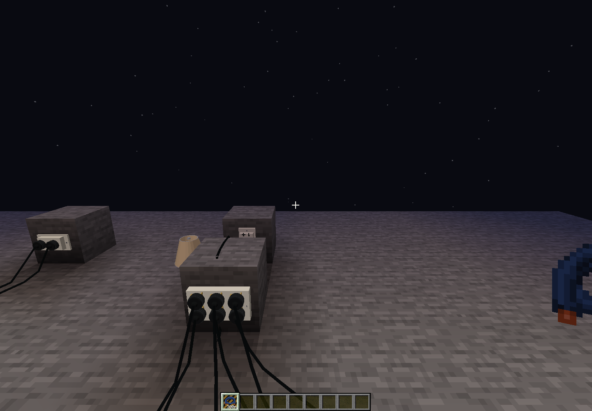
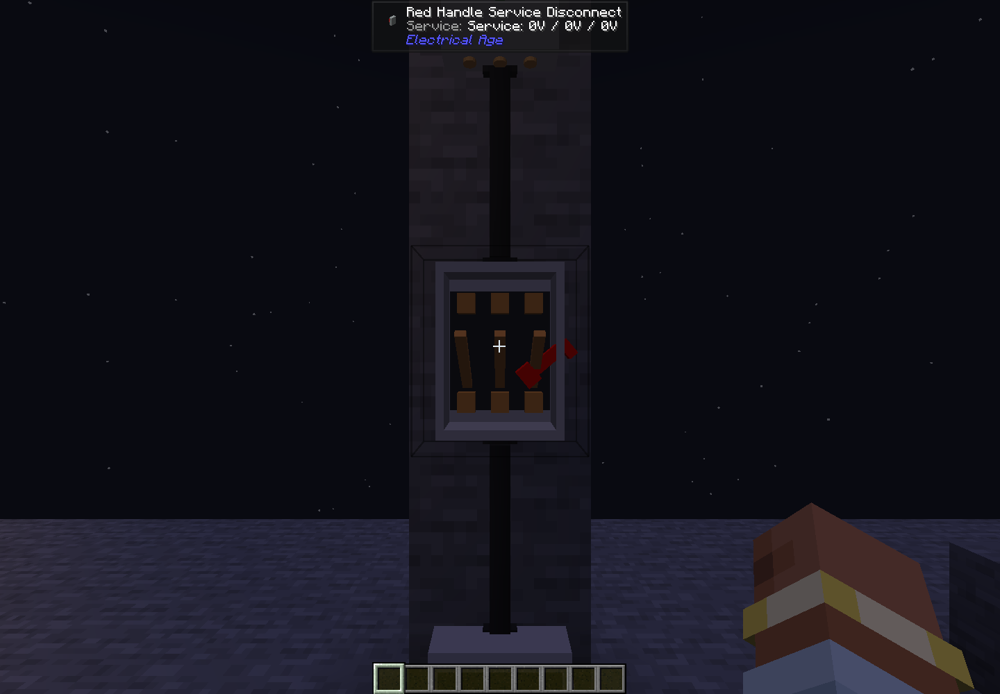

# Household distribution updates (3.0.28)

A fixture with twenty 240 V halogen bulbs has a nominal load of **5,400 W / 22.5 A**. Halogen filaments are currently fixed resistances; this version does not add an inrush multiplier. Wireless panel demand now tracks each fixture by identity, so repeated reports replace its previous load rather than adding another copy. Switching or unloading a fixture removes its contribution. Real voltage changes and additional fixtures on the same circuit still change current. The panel's upstream breaker continues to protect corded and wireless loads.

## Physical transformer upgrades and fuse cartridges

Five distinct **10, 25, 50, 75 and 100 kW Pole Transformer** items fit the existing transformer slots. Each successive recipe consumes the previous transformer, four Iron Plates and four Copper Cables; the 10 kW tier starts with a Mains Step-down Unit. Larger transformers therefore cost more cumulative material. The installed item sets capacity; the pole GUI displays it and cannot grant a larger rating. Choose nominal secondary voltage in the GUI as before. The primary nominal remains **12.47 kV**.

The original Mains Step-down Unit still fits as a 10 kW pole transformer. Its standalone block retains its original adjustable converter behavior. Existing placed poles with a higher GUI-selected legacy unit migrate that unit to the corresponding physical item. The older Utility Pole w/DC-DC Converter has a new upgrade slot; its built-in unmodified transformer remains 10 kW. Breaking a pole returns its removable transformer separately and cannot duplicate the upgrade through saved pole settings.

Cutouts now hold removable physical fuse cartridges. The pole recipe includes its original basic Pole Fuse Links. Sneak-right-click a fused pole with an empty hand to remove the first fitted fuse. Right-click with a new link or rated fuse to install it in the first empty/blown holder. An empty holder stays open after saving and reloading. A blown cartridge becomes a **Blown Pole Fuse** when removed. Fitted cartridge state travels with the pole item when it is moved.

Rated **1, 2, 3, 5, 8, 10, 20, 30, 50, 100 and 200 A Pole Fuses** override the old GUI current setting. Their ratings refer to primary current. Existing generic links retain their previous automatic transformer protection or saved cutout rating. Recloser pickup remains configurable because it is a separate protective device.

## Outlets and power strip

The former Experimental Wall Outlet displays as **120 V Wall Outlet**, retaining its original registry ID and all placed blocks. **240 V Wall Outlet** keeps its name. Both have two independent sockets. The first appliance uses the lower socket, the second uses the upper socket, and a third is rejected. A carried appliance keeps its reserved socket. Old saved single-cord links occupy the lower socket. Release lost cords through the outlet GUI if their appliances are permanently missing.

Outlets have passive contacts and **no internal circuit breaker or overvoltage trip**. Put them downstream of an appropriately rated panel breaker. Their 20 A nominal label is a wiring/device rating, not an internal current clamp. Old saved tripped outlets resume ordinary passive operation.

Use **Mount: Vertical / Horizontal** in the outlet GUI for countertop-style sideways mounting. The case, plugs, cord attachment positions and collision shape rotate together. Both wall outlets continue to support direct wall cables or a wireless Lamp Supply/panel channel without changing voltage.

The **Six Socket Power Strip** is a wall-mounted 120 V strip. Select a 120 V outlet with a flexible cord, then click the strip to feed it. Select a strip socket with another cord to connect an appliance. Its six socket reservations are independent and a seventh connection is rejected. The strip can instead use wall cables or a wireless channel. A cord feed takes priority over those modes; cyclic strip-to-strip links are rejected. It shares upstream branch protection rather than adding an internal breaker.

## Pass-through streetlight poles

**Single Phase Secondary Fed Street Light Pole** and **Three Phase Secondary Fed Street Light Pole** carry the HV conductor(s) and a separate 120/240 V secondary rack. Their lamp draws from the rack's L1 120 V service. HV alone will not illuminate them: connect their lower racks to a real upstream transformer pole's secondary. They include neither a transformer nor a primary transformer fuse. Aim-based HV/LV linking and automatic three-phase spans work as on the other utility poles.

## Red-handle service disconnect

Place a **Red Handle Service Disconnect** under the meter, between its bottom cable terminal and the panel's top terminal. Use placed wall cables. Top is the selected service input; bottom is its switched output. Use a 240 V feeder for the panel's 120/240 V service equivalent. The disconnect has three real contacts, so opening it isolates all downstream service channels while the meter stays powered.

Right-click with an empty hand to operate the red handle, or use the service button in its GUI. The handle and copper knife blades visibly open with the contacts. The switch position is saved and restored after reload. This is a manual disconnect; the downstream panel breakers provide branch overcurrent protection.

## Validation

Release 3.0.28 passed **742 unit tests**, with zero failures, errors or skips, plus crafting-data generation and **24 native Minecraft checks** in `utility-distribution-1792539566587`. The native campaign checks the real 5,400 W branch, proportional voltage changes, both duplex plugs, six cord-fed lamps, physical transformer/fuse items, the manual service disconnect, and a full world save/restart. The chandelier branch remained below 26 A through voltage sag/rise, switching and restart.

Run the opt-in campaign with `-Deln.utilityDistributionChecks=true` and the `runClient` Gradle task; it is disabled in normal play. Its report is `run/client/utility-distribution-checks.json`. See [Ubuntu build instructions](building-on-ubuntu-24.04.md) to compile `ElectricalAge-3.0.28.jar`.
