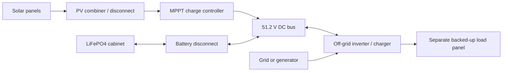

# Off-grid solar and LiFePO4 storage

A solar installation with battery backup needs separate DC charging, battery storage and household-voltage conversion. The **Off-grid Inverter Charger** combines an inverter, an AC battery charger and an automatic transfer contact. Its AC input can come from the grid or a generator. Grid-to-battery conversion is rectification/charging; battery-to-household conversion is inversion. It never exports into the AC input.

The new system uses a **51.2 V nominal DC battery bus**, with a **56.8 V charging target**. Existing solar panels, electrical cable, grounds, distribution panels and protection devices remain usable. The existing hybrid solar inverter retains its original behavior and small DC link; it is not silently converted into a battery cabinet.

The standalone AC charger is an alternative way to charge the DC bus; it is not required when using the inverter/charger's built-in charger.

## Parts and wiring

| Part | Function and terminals |
| --- | --- |
| Fused PV Combiner and Disconnect | Combines two PV positives through individual included 30 A fuses. Left and front are string positives, right is combined positive, rear is the common PV return. Rated to 1000 V DC. Its handle disconnects both positive inputs. |
| LiFePO4 MPPT Charge Controller | Harvests up to 10 kW into a 56.8 V battery bus, with a 200 A output ceiling. Left blue is PV+, rear black PV−, right red battery+, front black battery−. It blocks reverse power into the panels. |
| Off-grid Inverter Charger | Up to 12 kW at selectable 120 or 240 V. Left is battery+, rear battery−, front blue is grid/generator input, right orange is the isolated backed-up load output. The AC input and backup output must remain separate circuits. |
| AC LiFePO4 Battery Charger | Standalone 120/240 V input charger for the DC bank. Left is battery+, rear battery−, front blue AC input. It does not have an inverter output. |
| 400 A DC Battery Disconnect | A manual positive-bus disconnect with an overcurrent trip. Left is the bank side, right the inverter/bus side. Clear an overload before resetting it. |
| LiFePO4 battery cabinets | DC storage with an integrated BMS and disconnect. Left red is positive, right black negative. Use an inverter for household-voltage loads. |

Wire all PV string negatives to the combiner's common return, then to MPPT PV−. Keep this PV return separate from the battery return unless deliberately bonding them with the existing grounding parts. Connect the MPPT's battery terminals and the inverter's battery terminals to the battery bus with physical cables. Positive and negative cables must not touch each other. Grounding/reference rules are the same as other ELN batteries and converters.

Put the DC disconnect between bank positive and the inverter's DC positive bus. The inverter's AC input can be supplied through the existing ATS if grid/generator selection is needed. Its backup output feeds the separate household load panel. External power on the backup output trips protection rather than creating a grid-export connection.

ELN models these household-voltage devices using its existing steady-state electrical solver. The simulation accounts for current, voltage, isolation, transfer contacts and conversion losses; it does not model an AC waveform or phase synchronization.

## Batteries

Each capacity has a floor cabinet and a wall-mounted version. All are **two blocks tall**. Wall batteries project 0.33 blocks and need solid support behind both blocks; their upper occupied cell keeps a shallow collision shape.

| Capacity | Stored energy | Continuous BMS current |
| --- | --- | --- |
| 16 kWh | 57.6 MJ | 100 A |
| 32 kWh | 115.2 MJ | 200 A |
| 48 kWh | 172.8 MJ | 300 A |
| 64 kWh | 230.4 MJ | 400 A |

The cabinets are crafted empty. Craft a **16 kWh LiFePO4 Cell Stack** from battery modules and build cabinets with one, two, three or four stacks. Cell stacks are construction parts, not charged portable batteries. The capacity of a bank does not increase the inverter's 12 kW rating. A smaller bank can reach its BMS current limit before the inverter reaches full power.

The BMS limits charging and discharge, prevents overcharge and unpaid output from an empty bank, and disconnects on reverse polarity, excessive voltage or overheating. Charging operates at an actual cell temperature of 0–55°C; above 65°C the BMS disconnects. The temperature display includes local ambient temperature. Displayed energy, protection state and charge are saved with the block and retained when it is moved. Configuration-tool copies contain settings only and cannot copy stored energy.

Cabinets on the same nominal bus can be wired in parallel. Match voltage and state of charge before connecting banks. Do not put these banks in series: the charging and inverter equipment is designed for one 51.2 V bus.

## Inverter modes and controls

- **Backup reserve; grid charging:** matching AC input supplies the backup load through the transfer contact while the charger fills the battery. Loss of AC opens the grid contact before enabling battery inversion.
- **Solar/battery first; grid backup:** the inverter uses the DC bus. A low DC bus requests grid backup and charging; a higher recovered bus releases that request. Solar contributes through the MPPT on the same bus.
- **Off-grid; AC input disabled:** loads use the battery/solar bus and the AC charger and grid bypass remain open.

Automatic transfers include an open interval of at least 250 ms. Select **120 V** or **240 V** on the inverter's screen. Direct grid bypass requires AC input close to that selected voltage. A 120 V source can still charge the DC bank while the inverter supplies a separate 240 V output.

Charging current is adjustable from 0 to 200 A DC. The charger also respects a 12 kW output ceiling and 100 A AC input ceiling, and the bank may impose a lower current limit. When using grid bypass, the charger reduces its draw to leave headroom for the household load within that same 100 A input limit. Conversion losses and battery charging losses are accounted for as heat. Once a bank is full, charging stops; solar harvest curtails when no load or storage capacity remains.

Screens and cabinet indicators show operating state, charging, faults, DC voltage, power and battery charge. **Disconnect** isolates the bank or stops the selected appliance. **Reset protection** retries after the physical fault has been cleared; it does not replace a blown PV fuse. Use a fresh fuse item rated at 30 A or less to replace a combiner fuse; sneak with an empty hand to remove a cartridge.

Use the same ELN version on server and clients. EA Media 1.0.12 remains compatible and is optional for this power system.
