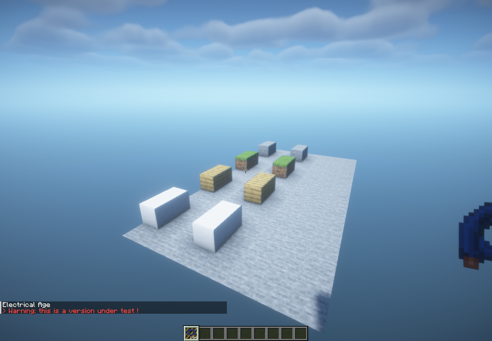

# 3.0.34 panel feeders and shader-compatible wire covers

## Panel supply terminal

The bottom terminal previously always connected to the selected breaker's **output**. A meter cable connected there could backfeed the 240 V bus while that breaker was set to 240 V. Changing it to 120 V disconnected the 240 V bus instead of supplying both 120 V banks. The regression reproduced a 240 V feed leaving one bank near 240 V, the other at zero, and the 240 V bus at approximately `2.18e-27 V`.

The panel GUI now selects **240 V feeder: Top / Bottom**. The selected side connects directly to the service bus; the opposite vertical terminal remains the selected breaker's protected output. Changing the selected circuit or its voltage cannot reassign the feeder. Switching feeder sides rebuilds physical connections, and the setting is published to clients and saved in both world NBT and the picked-up item. Existing saves retain Top as the feeder so previously valid branch-output wiring does not silently become an unprotected service connection.

**For a meter supply cable entering from below, select “240 V feeder: Bottom” in the panel GUI.** Supply it with 240 V; its 120 V banks continue following half the actual feeder voltage, including sag, rise and outages.

`CabledPanelRegressionTest` exercises both feeder sides with ideal, regulated and fixed-ratio pole-transformer supplies; 1, 5 and 12 installed breakers; and 1 or 120 cable junctions. It repeatedly changes mixed branches between 240 V and 120 V and verifies every installed branch and the service bus. A second regression covers pickup persistence and old-save terminal assignments. Existing proportional-voltage and energy-conservation tests are retained.

## Wire cover rendering

Camouflage previously ran the world tessellator inside a block entity renderer. Shader packs still received block-entity geometry, rather than terrain geometry, and the six-node's material identity. Matching vanilla vertex colors alone could not fix that distinction.

Covers now use a delegating terrain baked model with immutable NeoForge ModelData. It forwards the original block's quads, render layers, model-specific data, ambient occlusion, particles and biome tint. The six-node delegates shading, view blocking and dynamic occlusion to its cover. Uncovered devices have empty terrain occlusion; non-occluding covers retain that behavior. NeoForge's appearance hook exposes the original block state to Iris for shader material IDs. Device/cable geometry stays in the block entity renderer, without drawing a second cover cube there.

Client load and cover changes request model-data refreshes; changing or removing a cover also dirties terrain and updates lighting. Chunk workers use the published immutable cover snapshot. No rendering-mod dependency is added.

## Verification

The full `./gradlew --no-daemon --max-workers=3 test` suite passed **798 tests**, with zero failures, errors or skips. The bottom-feed regression failed before the fix and passed afterwards.

Two native Minecraft campaigns passed **six checks** using Sodium **0.8.13+mc1.21.1**, Iris **1.8.14-beta.1+mc1.21.1** and **BSL 10.1.8**, with Mesa llvmpipe rendering:

- The actual GUI feeder button and client/server publish packet select the bottom input.
- A meter and placed cables supply a bottom-fed panel, a wireless 120 V outlet, a corded mini fridge and an independent 240 V lamp together.
- Selecting another breaker leaves both branches powered.
- Stone, grass, planks and quartz covers beside other covered blocks match ordinary blocks in quads, texture coordinates, tint, directional shading, ambient occlusion and light. The original shader appearance is asserted for each face. The test waits for visible terrain sections before capturing the BSL comparison.
- Replacing a cover refreshes the terrain snapshot and tint.
- Removing it clears terrain geometry.

[Machine-readable results](verification/release-3.0.34/results.json)



Commands for the opt-in native checks (a display/OpenGL context is required):

```bash
JAVA_TOOL_OPTIONS="$JAVA_TOOL_OPTIONS -Deln.coverRenderingChecks=true" ./gradlew --no-daemon --max-workers=3 runClient
JAVA_TOOL_OPTIONS="$JAVA_TOOL_OPTIONS -Deln.panelFeederChecks=true" ./gradlew --no-daemon --max-workers=3 runClient
```

Reports are written under the client run directory as `cover-rendering-checks.json` and `panel-feeder-checks.json`. Native checks exit after recording their results; inspect the report's failure field as well as Gradle's exit status.

The release is source-only. Compile with JDK 21 using `./gradlew --no-daemon --max-workers=2 build`; the output is `build/libs/ElectricalAge-3.0.34.jar`. See [Ubuntu build instructions](building-on-ubuntu-24.04.md).
