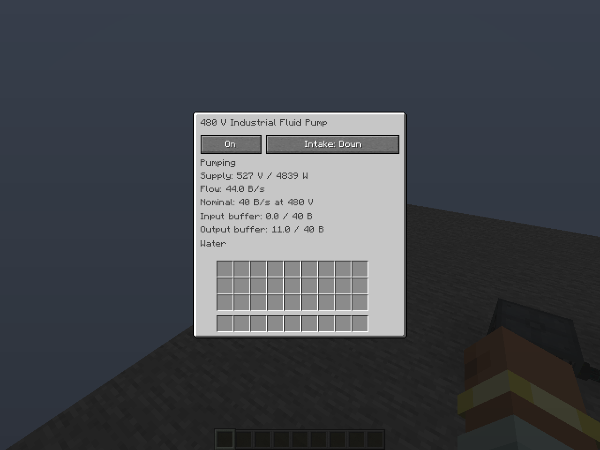

# 3.0.35 pump and rendering investigation

## Supplied profiler ZIP

The supplied `2026-10-21_19_16_26-Minecraft Server-1_21_1.zip` contains
`client/profiling.txt`, client metric CSVs, client options and system details.
There is no server-thread profile, `Simulator.tick()` call tree or ELN simulation
measurement in this attachment. Its filename is not evidence of server contents.

The capture lasts 10.015 seconds. It records 101 rendering passes (10.08 recorded passes/s), 198 client ticks (approximately 19.77/s) and 299 profiler-loop samples.
The dump's “29.85 ticks per second” is that mixed client loop count, not server
TPS. Client `ticking.csv` has a median sample of 32.08 ms, p95 43.73 ms and maximum
148.41 ms; it is not a server MSPT measurement.

| Profile section | Share of total recorded time |
| --- | ---: |
| `gameRenderer` | 78.12% |
| World block entity rendering | 33.35% |
| ELN `SixNode` | 17.95% |
| Unspecified block entity rendering | 15.31% |
| Entity draw buffers | 22.99% |
| Shader shadow pass | 7.30% |
| `updateDisplay` | 14.08% |

`SixNode` runs 16,624 times across 101 rendered frames, approximately 165 node
renders per frame. Its `UtilityCable` child accounts for only 0.04% of the whole
capture. The remaining 17.91% is unspecified, so this profile cannot identify
which ELN lamps, sockets or other six-node devices dominate it. The unspecified
block entities and draw buffers may include ELN and other mods; these percentages
must not all be attributed to ELN. Nested rows overlap and must not be added.

The client uses BSL 10.1.8 High at 3440×1440 with a ten-chunk render distance.
This supports investigating client rendering and shader work. It does not prove
an electrical convergence failure, server lag, a specific mod conflict, or how
much FPS any source change will recover on the user's world.

## Changes justified by the rendering path

- Display lists without local matrix commands now retain no relative transform.
  Previously recording unnecessarily inverted the camera/model matrix to produce
  an identity transform, then replay multiplied it into every model and normal
  matrix on every frame.
- Consecutive vertices sharing a normal reuse its transformed, normalized value
  within that emission. Ordinary quad faces perform one normal calculation
  rather than four. Changing animation, camera, tint and lighting remains live.
- Unplugged six-node devices no longer construct unused cord attachment vectors.
- The `SixNode` profiler section now separates neighbor-light lookup, each item's
  actual descriptor name and attached cord drawing. A subsequent vanilla client
  dump can identify which fixtures need further work.

These are bounded CPU reductions in ELN's shared model renderer, not an estimate
of an FPS gain or a substitute for a server Spark profile. Reproduce the same
camera/world with shaders enabled and disabled for comparison; use Spark on the
server during both stationary lag and chunk/line changes to investigate the
simulation separately.

## Pump and verification

See [pump operation](industrial-fluid-pump.md) for voltage, flow, intake and pipe
configuration. The pump uses a passive electrical motor load, separate raw and
pumped tanks and post-electrical energy accounting. No nonlinear converter is
introduced for this appliance.

The opt-in `-Deln.pumpChecks=true` native client integration passed eight checks
with Ender IO **8.2.12-beta** and NeoForge **21.1.249**, exercising the real
capability, conduit network, tank, electrical simulator, menu and sound engine:

- Renewable world water, with actual delivery through Ender Fluid Conduits to
  two real pressurized fluid tanks. After settling, measured production was
  **39.9982 B/s at 480 V**, **35.9984 B/s at 432 V** and **43.9980 B/s at 528 V**.
  The small difference follows real supply-cable voltage drop.
- A single conduit-to-tank path first measured **32 B/s**, consistent with
  8,000 mB per five-tick path transfer. Adding a second insertion destination
  removed that path bottleneck without changing either mod's transfer rules.
- Cached display-list emission matches mathematical vertex/normal transforms
  across three changing camera transforms, local animation transforms,
  nonuniform scaling and live inherited colors.
- The original `eln:industrial_pump` sound loads and plays through Minecraft;
  pitch and volume follow published operating data. Headless OpenAL uses its
  no-output driver; this checks playback, not subjective acoustic quality.
- The production GUI opens and a client button click disables the pump, publishes
  its off state and silences the loop. `pump35-gui.png` was inspected for layout.
- A finite lava source is removed and exactly 1,000 mB reaches the output.
- An adjacent Ender IO tank supplies another mod's source fluid, with exactly
  5,000 mB transferred through the pump/conduits and no source fluid remaining.

The native runner writes `run/client/pump35-checks.json` and a screenshot under
`run/client/screenshots/`. It runs only when opted in, requires Ender IO for its
reflection-based integration fixture, and does not add a production dependency.
The production pump works with standard NeoForge fluid capabilities alone.

[Native results](verification/release-3.0.35/pump-results.json)



With Ender IO installed in `run/client/mods/` and a working display/OpenGL context:

```bash
JAVA_TOOL_OPTIONS="$JAVA_TOOL_OPTIONS -Deln.pumpChecks=true" ./gradlew --no-daemon --max-workers=3 runClient
```

The complete `./gradlew --no-daemon --max-workers=3 test generateLangFiles runData`
run passed **804 unit tests**, with zero failures, errors or skips. Translation
and recipe/model/advancement generation also completed successfully. The six
pump unit regressions cover actual MNA voltage-dependent work, simulated fluid
operations, separate input/output paths, typed-fluid safety, persistence and
unpowered/unsafe-voltage behavior. [Unit result summary](verification/release-3.0.35/unit-results.json)

The release is source-only. With JDK 21, run
`./gradlew --no-daemon --max-workers=2 build` to produce
`build/libs/ElectricalAge-3.0.35.jar`. See [Ubuntu build instructions](building-on-ubuntu-24.04.md).
