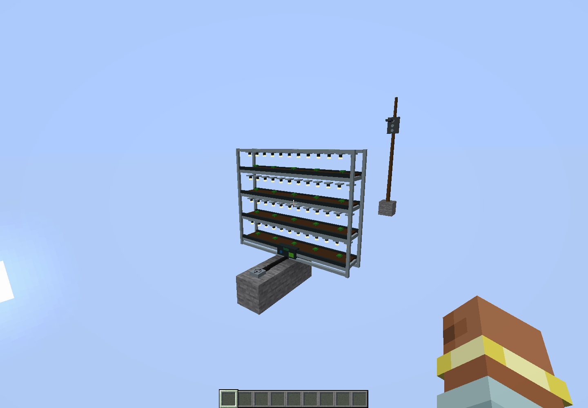
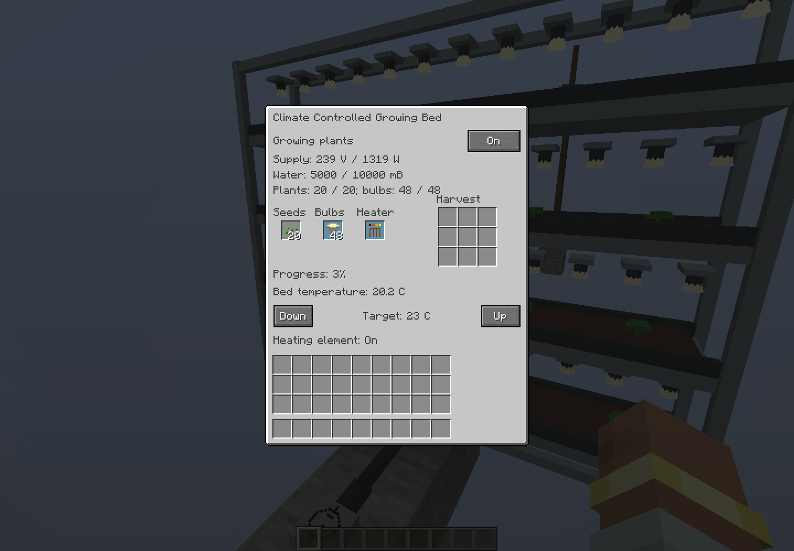
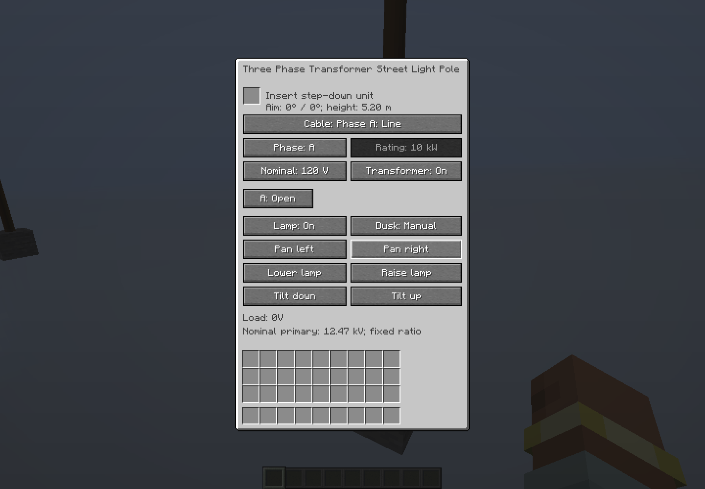
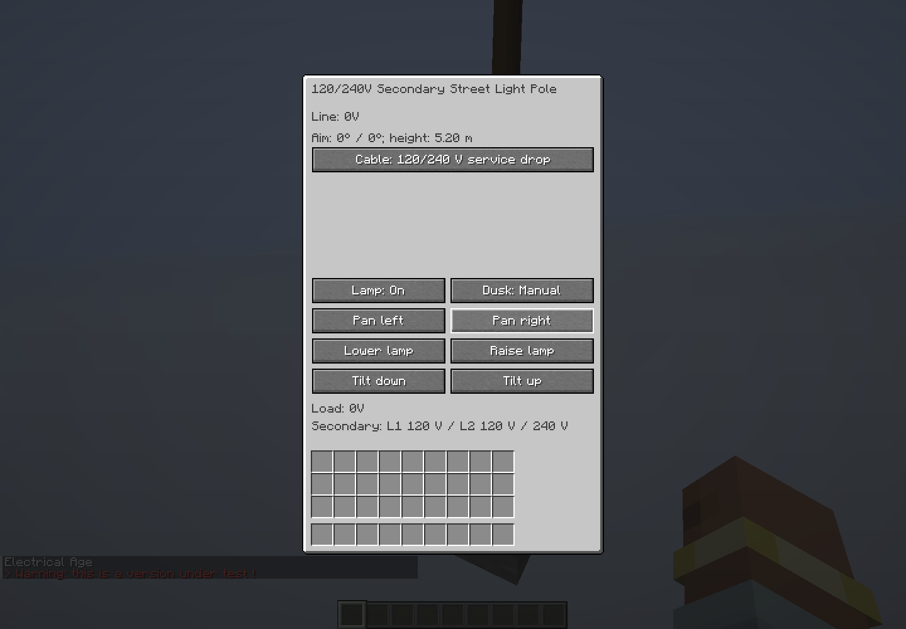

# 3.0.44: wind-grid stability, pole screens and a growing bed

Addresses a reproduced failure with ten large wind turbines feeding one
3.3 kV target-voltage converter, two Large Generators directly feeding the
shared 3.2 kV nominal bus, and another target-voltage converter stepping that
bus up to 15.2 kV. Changes in wind or load could leave the coupled solver on an
inconsistent limited branch and trip the converters' numerical protection.

## Electrical changes

The bounded Newton correction now accounts for power when comparing residuals.
Tiny voltage errors on a stiff port can represent large current errors; a
voltage-only merit function could overlook them. Source groups use second-order
finite differences and a simultaneous-response fallback when the existing
serial correction stalls. Ordinary converter and shaft/pole groups retain their first-order serial
correction, including asymmetric parallel regulator behavior. The more expensive
source correction is restricted to groups with bounded renewable ports.

Trials snapshot every source owned by a controller, including output commands
eliminated from its free trial vector. Physical source bounds apply to numerical
guesses, and mask-changing candidates are backtracked before the outer solver
reconciles them. Boundary recovery brackets renewable voltage, power/current
and weak-input load transitions, coordinating matching isolated wind inputs.
Every accepted result still passes device current, power, ratio and energy
checks before the single physical commit. Fault timers and power ratings are
unchanged.

Renewable supplies retain their operating guess between physical steps. Starting
or recovering sources seed attached converter inputs and cascaded target outputs
together. Target-voltage transformers no longer use an obsolete ratio to
backfeed an undriven idle primary. Fixed-ratio reverse induction and target-mode
reverse transfer with a driven primary remain available.

Large renewable modules now have a 5.12 ohm output winding rather than 0.02 ohm.
This represents a 1 percent voltage drop at the 20 kW wind module's 3.2 kV
rating and provides modest physical damping. Their no-load voltage remains
3.2 kV and environmental power budgets remain 20 kW for wind / 10 kW for water.
The change adds real winding losses and voltage droop under load; it does not
increase available power or relax convergence protection.

## Pole screens

The lamp aiming readout has its own row below the transformer slot / line
voltage, above the connection selector. Previously secondary-fed street-light
poles drew aiming and line voltage on the same row, while transformer lights
could overlap the installed-unit message. Readouts are bounded to screen width.
An opt-in native GUI check opens all five distribution street-light variants
and captures their screens (`-Deln.poleGuiChecks=true` with `runClient`).

## Growing bed

Adds the [Climate Controlled Growing Bed](climate-controlled-growing-bed.md):
a baked 5 x 4 x 1 four-tier rack, 20 planting positions, 48 matching bulbs,
a heating-element slot and thermostat, water input, and pipe-extractable harvest
storage. It runs on 240 V cords or placed cables. Committed electrical power,
local temperature and available water govern production; mature crop loot comes
from the crop's own loot table. Planting stock is retained for replanting.
It uses a new descriptor ID, preserving the existing dryer outlet and other IDs.

## Verification

`WindBankGeneratorGridTest` uses the production MNA solver, actual Large
Generator elements at maintained 202 rad/s, production renewable controllers
with the production 5.12 ohm winding, and production safe-transformer controllers:

- One shared 3.3 kV wind converter and a 15.2 kV step-up converter.
- Ten separately converted wind turbines sharing the generator bus.
- Both process registration orders; converter winding/feeder resistances of
  0.000001, 0.01 and 1 ohm.
- Nominal load steps of 1, 20, 60 and 100 kW, and per-turbine available power
  steps of 0, 1, 5, 15 and 20 kW.
- Sustained unequal wind budgets and an additional 850 V target-mode converter
  feeding the load downstream of the 15.2 kV step-up.
- Every physical step retaining energized intermediate/HV buses, no converter
  convergence trip, nonzero wind contribution when available, and bounded
  turbine power/current with no backfeed.

These 16 circuits cover 12,800 physical steps (128 simulated seconds).
`TransformerIdleInputTest` checks idle target-mode isolation and retained
fixed-ratio reverse induction. The existing parallel renewable audit includes
ten supplies. Existing hybrid-solar overload/recovery, short-circuit,
reverse-power, weak-source, converter, generator restart and pole-grid tests
remain part of the full suite.

These are electrical circuit regressions, not a Minecraft saved-world replay
of the user's grid. Shaft speed and available environmental power are controlled
boundary conditions; full rotor/weather/chunk behavior is outside the fixture.
The full suite passed 858 tests across 210 suites, with no failures, errors or skipped tests. Results are recorded in
[the unit result summary](verification/release-3.0.44/units.json).

This is a source-only release. Build `ElectricalAge-3.0.44.jar` using the
[Ubuntu instructions](building-on-ubuntu-24.04.md) and attach the compiled jar
separately.

The growing-bed tests cover fluid fill simulation, liquid rejection, protected
service slots, atomic output backpressure, power/darkness/temperature limits,
thermal inertia, and persistence of a paid crop batch. The native check uses
actual registered blocks, a placed 240 V cable, standard fluid/item capabilities,
48 bulbs, a heater, and mature wheat loot. It verifies nonempty baked geometry across section boundaries, unchanged mesh
identity during GUI progress updates, power-loss pause and water exhaustion. The native harvest wait is shortened by initializing progress
near completion after measuring real powered growth; unit tests account for
the full cycle duration. It does not claim an Ender IO installation replay.

The [native result](verification/release-3.0.44/native.json) records ten successful
checks. Captures use Sodium/Iris with the shader pack disabled and a software
renderer; they are visual/function checks, not an FPS benchmark.

