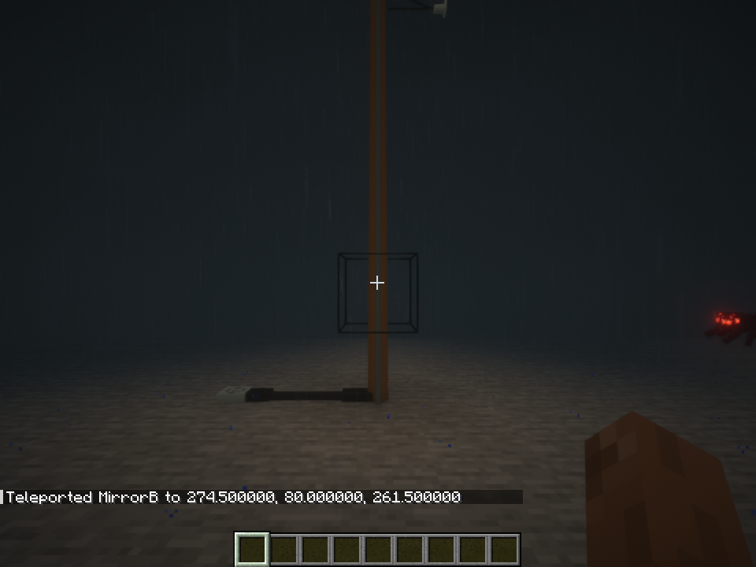

# 3.0.63: Removable pole streetlights and single-phase underground risers

Ordinary distribution poles, legacy utility poles and 69/230 kV poles/towers accept a physical
**Pole Streetlight Attachment**. Its 70 W lamp uses only the connected 120/240 V secondary.
Primary voltage alone never powers it. Shift-right-click with an empty hand opens rotation,
height, tilt, voltage selection, dusk operation and removal controls. Picking up the pole retains
its attachment and settings; removing the attachment returns the item once.

Dedicated built-in streetlight poles are vaulted from new creative selection and crafting.
Their IDs, saved blocks and existing behavior remain supported. New installations use an ordinary
pole with the removable attachment. Steel transmission poles gain an independent secondary rack
and bottom service terminals; these do not connect their primary circuits to their secondary.

The **Single Phase Underground Feeder Pole** brings a buried primary up to its overhead conductor.
The **Single Phase Transformer Pole with Underground Service Riser** supplies underground
120/240 V service from its overhead primary using existing physical transformers and fuses.
Its nominal primary is 12.47 kV, with proportional output sag/rise. See the
[installation guide](american-underground-service.md#pole-risers-and-removable-streetlights-3063).

Static parts use the terrain mesh and distant-model path. Geometry comparison confirms that every
existing distribution-pole part is unchanged; only `SecondaryServiceRiser` was added.
No media runtime or browser archive is added to core ELN.

## Verification

The complete ordinary build, language generation and data generation pass: **984 tests in
236 suites**, zero failures, errors or skips. There are no new test exclusions. The prior twin-light
creative-tab expectation now checks its requested vaulted status while retaining its ID and
legacy electrical/migration checks. New tests cover secondary-only loading, supply sag, physical
item accounting, placement data and the new underground terminals.

[Unit results](verification/release-3.0.63/units.json) and
[package/model checks](verification/release-3.0.63/packaging.json) are recorded separately.

A localhost dedicated server and native client with Sodium 0.8.13, Iris 1.8.14 beta, BSL 10.1.8
and Distant Horizons 3.3.3 verify the actual placed fixtures and
[GUI operations](verification/release-3.0.63/native.json): primary-only feeder lamp 0 W;
separately fed 240 V feeder lamp 70 W; transformer fixture about 119.998/239.995 V and 69.997 W
from its 12.47 kV overhead feed. Rotation to 345 degrees, raising, tilt to -5 degrees and removal
all reach the server. Removing the lamp leaves zero light and only numerical leakage power.
The physical sources and simulation advance normally; these are not client-only display values.

Source-only prerelease. Compile with a full JDK 21 and attach
`build/libs/ElectricalAge-3.0.63.jar`. Update server and clients together: the core protocol changes
for attachment display/control data. [Ubuntu build instructions](building-on-ubuntu-24.04.md).
