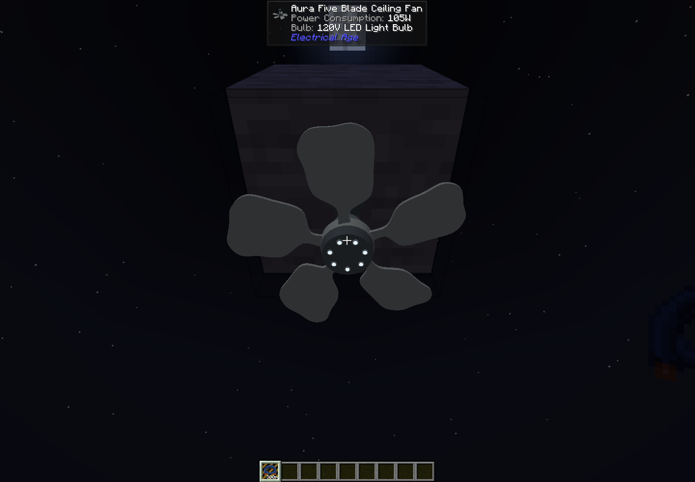

# Utility distribution and house service (3.0.27)

For 3.0.28, see [household distribution upgrades](household-distribution-upgrades.md): physical transformer ratings and fuse cartridges replace the older GUI capacity settings below; the guide also covers duplex outlets, the power strip and the red-handle service disconnect.

All existing poles and transmission towers are three blocks taller. Existing block/item IDs, overhead spans and streetlight settings remain compatible. Pole transformers now use a fixed 12.47 kV nominal primary, so their secondary voltages follow the grid. Saved poles reserve extra clearance when the surrounding chunks load; the upgrade never replaces player-built blocks.

## Overhead circuits and service drops

The new **Single Phase Utility Pole** has one overhead conductor. **Three Phase Utility Pole** has three independent conductors, A, B and C. With an intact power cable in hand, aim at the pole's actual HV tie points or lower secondary rack. Clicking two three-phase HV tie points makes all three independent phase connections in one action; each phase pays for its own conductor. Aim at the Line or Load side of protective equipment as appropriate. Hold **Shift** while clicking to use the phase/terminal selected in the GUI instead. A three-phase-to-single-phase span defaults to phase A; Shift allows an explicit matching phase. A connection between mismatched new phase or voltage terminals is rejected.

Every pole, including the existing variants and towers, has an independent secondary rack. Aim at the lower secondary rack to link all three service channels at once. The manual **120/240 V service drop** selection remains available with Shift. Use a cable spool for long bundles; ordinary stackable cable items are limited to one stack of paid conductor length. The bundle uses three metres of cable per block of span and renders three sagging conductors. Each has its own resistance and thermal state. Individual L1 120 V, L2 120 V and 240 V terminals are also available. Unpowered racks pass the secondary through; they do not generate voltage.

The simulator uses DC-equivalent circuits. A/B/C are independent power networks, not AC phase angles. The service bundle represents two independent 120 V load circuits and one 240 V load circuit, with the return reference implicit. It does not simulate a physical neutral conductor, split-phase waveforms or neutral imbalance. All three outputs draw from the same real transformer. The selected kW rating sets its primary fuse and winding thermal capacity; an overload can exceed the rating briefly before protection opens.

## A working pole-to-house connection

1. Feed a **Three Phase Underground Feeder Pole** with three separate floor cables: left A, right B, rear C. The front follows placement direction.
2. Link its A/B/C overhead terminals to the matching terminals on other three-phase poles. Protection poles have separate **Line** and **Load** terminals; the outgoing circuit must connect to Load.
3. Install a **Mains Step-down Unit** in a transformer pole by right-clicking with it, or using its inventory slot. Choose A, B or C on a three-phase transformer pole. The transformer uses only that phase.
4. Choose **10, 25, 50, 75 or 100 kW**. This is the transformer rating shared by the lamp, normal base output and service channels. Choose 120 or 240 V as the **nominal** normal base output at **12.47 kV** primary. The service rack has nominal 120 V, 120 V and 240 V circuits at that same primary voltage. Actual output follows the primary proportionally, with additional physical winding/cable drops. At 11.8465 kV (−5%), nominal 120/240 V becomes approximately 114/228 V; at 13.0935 kV (+5%), it becomes 126/252 V. The separate standalone Mains Step-down Unit retains active regulated output and the same selectable ratings.
5. Connect the secondary service bundle along secondary racks or **120/240V Secondary Utility Poles**, then to a wall-mounted **120/240V Service Weatherhead** on the house. The **Secondary Street Light Pole** runs its lamp directly from L1; it needs no transformer or primary fuse.
6. Run a **placed wall cable** from the weatherhead's bottom terminal to the top of a **North American Meter Base**; select 240 V for the weatherhead and meter top/bottom circuit. Insert an **Analog Glass Service Meter** or **Smart Digital Service Meter**.
7. Run a placed wall cable from the meter's bottom terminal to the top of a **Twelve Circuit American Breaker Panel**. New overhead spans terminate at the weatherhead; meter sockets and panels reject them.
8. Insert existing Electrical Breaker items into the panel. Give each desired branch a unique wireless power channel, then enter that name on lamps or outlets. Devices still need their normal bulbs and cable inserts. Outlets can supply the existing flexible cords.

The weatherhead exposes ordinary wall cables: left L1, right L2, and the top/bottom circuit selected in its menu. On a meter, top is the selected incoming circuit and bottom is the selected outgoing circuit; side terminals expose the outgoing 120 V branches. A 240 V placed feeder supplies the cabinet's 240 V bus and both 120 V service equivalents through passive, power-conserving taps. All outputs follow upstream sag; removing the meter still isolates every outgoing channel. This is the mod's scalar service equivalent, not an extra active voltage regulator.

Existing saved overhead connections to meters/panels continue to load and keep their original independent three-channel buses. The new passive wall-feed taps stay disconnected in that legacy mode. New installations use the weatherhead and placed cables. Do not mix legacy overhead service with a new wall feeder on the same cabinet.

## Protection and switching

- **Fused Cutout Poles**, single- and three-phase, contain cutouts without a transformer. Select the trip current in amperes. Each phase's fuse protects its own load terminal.
- Transformer poles, including the existing converter and streetlight poles, have a primary fuse. Primary fuse pickup is the selected watts divided by 12,470 V, independent of the instantaneous grid voltage. It responds to real reflected load current, rather than a converter current-limit flag. The older Utility Pole w/DC-DC Converter also uses 12.47 kV nominal primary; choose nominal 120, 240 or 3,200 V output in its menu. Old saves default to 3,200 V nominal on this older pole and keep their existing 120/240 V settings on streetlight/new transformer poles. There is no automatic primary calibration on load or restart. Existing grids below 12.47 kV will therefore have proportionally lower outputs after upgrading.
- A blown fuse drops its door open and plays a pop. Inspect/remove the overload, then right-click holding a **Pole Fuse Link**. A blown link cannot be reset by toggling the GUI or picking up/replacing its pole. Manual operation under load makes an arc; closing or re-fusing plays a quieter arc only if current actually starts flowing.
- **Three Phase Recloser Pole** opens every phase when any phase exceeds pickup current. Configure 1–2000 A pickup, 1–60 seconds retry delay and 1–5 failed reclosures. The first trip starts the retry sequence; each failed automatic reclosure counts toward lockout. Ten seconds of stable operation clears the failed-retry counter. Manual Open prevents automatic closing. Locked-out and manually open states survive world restart. Inspect the fault and use **Reset lockout** to close again.
- **Three Phase Gang Operated Air Break Switch Pole** opens/closes all three load terminals together. It does not automatically detect overloads.
- **Automatic Voltage Regulator Poles**, single- and three-phase, use passive, power-conserving taps. Their input cutouts use the same replaceable Pole Fuse Links. Each phase adjusts independently toward the selected target, within ±10% of its input voltage. Tap movement is at most one percentage point per second. Hold Tap freezes the current ratios. A regulator cannot produce power from an unpowered line or replace a large-ratio transformer.
- **Three Phase Pole Mounted Capacitor Bank** has three separate capacitor branches with inrush resistance and a high-resistance discharge path. It stores charge and smooths DC-equivalent voltage changes. AC reactive power and power-factor correction are not simulated.

Protection/retry clocks advance with physical simulation time, not solver convergence passes. The recloser bumps audibly on each operation. Opening a fuse or switch is not a replacement for clearing the original fault.

## Meters and panel

Both meter inserts complete the real service circuit. Removing either meter opens all three channels. The glass analog meter has five rotating register needles and a marked spinning disk. The smart meter displays imported kWh and has a manual service disconnect. Both menus show independent import/export registers; exporting never subtracts from the import register. Since 3.0.61, registers and serial numbers belong to the physical meter insert and follow it between sockets; existing installed meters migrate saved socket registers. Unloaded time is not billed. A server-side `setRemoteDisconnect` hook is reserved for a future remote integration; no remote communications system is advertised in this release.

The panel has twelve single-item breaker slots in two banks of six. Left slots default to L1 120 V and right slots to L2 120 V. Each branch may instead select the 240 V bus. Its breaker item supplies its ampere rating; an empty slot is open. The old unrated breaker is treated as a 400 A breaker. Every branch has a manual switch, persistent trip latch, wireless power channel and optional wireless control channel. Control choices match Lamp Supplies: Any On, All On or Toggle. Blank control means enabled; `true` and `false` are also supported. Wireless range is selectable from 32 to 512 blocks, within the same dimension.

Ordinary panel wall cables connect left L1, right L2, top 240 V, and bottom the selected circuit. Meters and panels do not offer a new overhead-link selector. Existing saved links remain compatible. Configure voltage before attaching loads. There is no additional whole-panel main breaker: use upstream fused/recloser protection and appropriately sized cables for the service rating. Individual 240 V branches use one ELN breaker circuit, rather than modeling a physical paired AC breaker.

Panel protection uses a thermal inverse-time curve. From cold, 10× rated current lasts about two seconds before tripping; a 5 A breaker can therefore carry a 50 A startup pulse for roughly 1–2 seconds. Sustained overloads still trip (approximately 66 seconds at 2×, 25 seconds at 3×, or 8 seconds at 5×). More severe faults trip much sooner. Residual heat is saved, and cools under normal load or while switched off. A tripped breaker must be reset manually.

Camouflaged placed cables use normal world-model lighting, ambient occlusion, directional shading, biome tint and position-seeded textures, so a cover matches its ordinary block instead of using item lighting.

Wireless lamp demand is charged to its own real branch. Wireless cord outlets connect passively to that same protected branch. Neither mode creates a second source. Tripping one branch leaves the others available. On unloading or removal, wireless bridges are removed before the panel's loads leave the simulator. Saved overhead spans are deduplicated between their two endpoint records after loading.

## Aura-style ceiling fan

The **Aura Five Blade Ceiling Fan** follows the supplied fan photos: satin gray finish, five swept blades with slim roots and inward-curving waists, bulbous rounded ends, and matching downward and leftward pitch, a roughly 36-inch span and seven recessed downward lights. Install up to seven bulbs of any supported lamp technology, using a matching voltage. Its fan and lights have independent controls, gradual startup/coast-down and the existing fan sound. It supports wireless lamp/panel channels, direct cables and the flexible cord system. It can mount on the same ceiling/slab surfaces as the other ceiling fixtures.

## Building and validation

Build the matching source tag using the [Ubuntu 24.04 instructions](building-on-ubuntu-24.04.md). The release page intentionally has no compiled jar; attach the locally compiled `ElectricalAge-3.0.27.jar`.

Release validation: **735 unit tests passed with zero failures, errors or skips** and **18 native Minecraft checks passed**, including the placed house feeder, shading comparison, inrush tolerance, proportional voltage changes and a cold restart. Native world: `utility-distribution-1792533525884`. Details are recorded in the [3.0.27 release notes](https://github.com/reamnet/ELN1.21.1ForkPatch/releases/tag/v3.0.27).

The opt-in native campaign is `-Deln.utilityDistributionChecks=true` with `runClient`. It places the registered production equipment, feeds three independent voltage legs through actual cables and overhead links, exercises panel and meter GUI inventory/buttons, observes protection sounds and saves/reopens its world. Its JSON report is `run/client/utility-distribution-checks.json`; a successful report must have no failure and the expected current world name/checks. This campaign is disabled in normal play.

For the two-wide bottom-entry socket, updated meter displays and single-phase buried service equipment, see [American underground residential service](american-underground-service.md).
